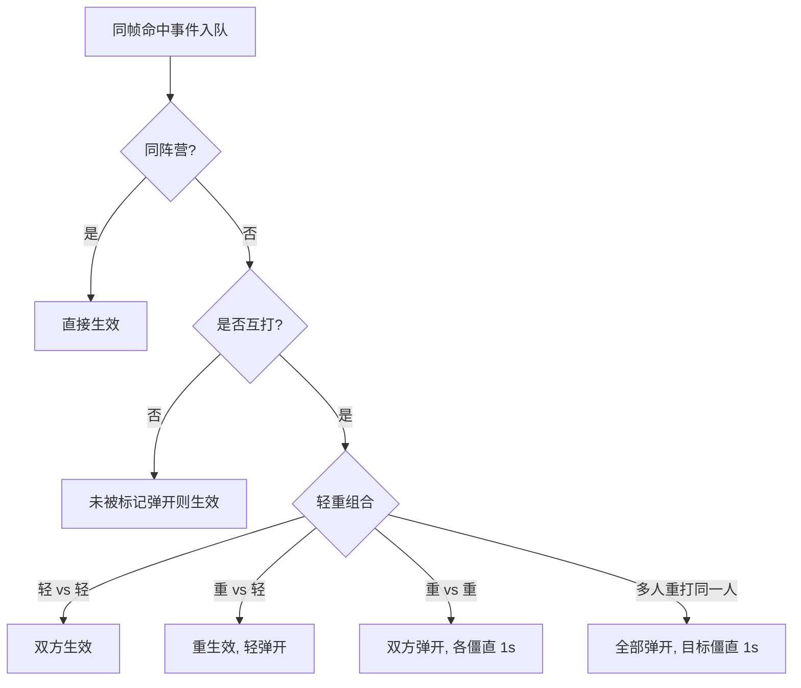

# HOOK AND FORK

> 零依赖、纯原生 JavaScript 实现的浏览器本地双人对战竞技小游戏 —— 红方「钩锁」拉拽眩晕，蓝方「钢叉」击退钉墙，把对手推入深渊即获胜。

---

## 项目简介

做一款**随手可玩、无需安装与构建**的 2D 竞技游戏原型并不难，难的是用最朴素的技术把一套完整的战斗闭环讲清楚。`HOOK AND FORK` 用 ES5 风格的 JavaScript + HTML5 Canvas，呈现了从「输入 → 武器状态机 → 命中检测 → 同帧仲裁 → 物理结算 → 胜负判定」的完整链路。

项目的设计核心是**两方武器机制不对称**：

- 红方 **Hook（钩锁）**：拉拽 + 眩晕，把敌人"拉过来"；
- 蓝方 **Fork（钢叉）**：击退 + 钉墙，把敌人"推过去"。

再叠加一套"重攻击克制轻攻击、重撞重双方弹开"的命中仲裁规则，用极少的代码量制造出可观的策略深度。它是学习**战斗系统（武器状态机 + 命中仲裁 + 网格化场地）**的极佳样本。

## 核心玩法

| 阵营 | 武器 | 机制 | 重攻击特性 |
| --- | --- | --- | --- |
| 红方 | Hook 钩锁 | 发射钩索，命中后沿出钩反方向把目标**拉向自己**并造成短僵直 | 需蓄力，拉力与眩晕更强 |
| 蓝方 | Fork 钢叉 | 瞬间突刺，命中后沿出叉方向把目标**击退**并造成僵直 | 击退力更大，目标撞到障碍/墙边则**钉墙 1 秒** |

- 场地内置随机生成的**障碍物**与**深渊格**（纯黑危险区），踏入即死。
- **胜负**：歼灭敌方全员，或 180 秒时限内存活人数多者获胜；同人数则平局。

## 安装部署

本项目**零依赖、零构建**，无需 `npm install`。三种启动方式：

1. **最简单**：直接用浏览器打开 `index.html`（双击即可）。
2. **推荐（本地静态服务器）**：避免部分浏览器对本地文件的限制
   ```bash
   # 在项目根目录执行（Python 自带）
   python -m http.server 8000
   # 然后浏览器访问 http://localhost:8000
   ```
3. **开发模式**：克隆后直接用任意编辑器打开修改，保存刷新即可生效。

> 运行环境要求：任意现代浏览器（支持 HTML5 Canvas 与 `requestAnimationFrame`）。

## 快速开始

1. 浏览器打开 `index.html`；
2. 大厅界面按 **空格** 进入操作说明；
3. 阅读说明后再次按 **空格** 进入 3-2-1-GO 倒计时；
4. 开战，把对手推下深渊。

## 操作说明

| 阵营 | 移动 | 瞄准 | 轻攻击 | 重攻击（蓄力） |
| --- | --- | --- | --- | --- |
| **红方 · Hook** | `W` `A` `S` `D` | 鼠标方向 | 鼠标左键 | 鼠标右键 |
| **蓝方 · Fork** | `↑` `↓` `←` `→` | 移动方向 | 逗号 `,` | 句号 `.` |

- 目标：将敌方推入深渊。
- 提示：重攻击克制轻攻击；重 vs 重 双方弹开；钩索/钢叉碰到障碍物会自动收回。

## 命中仲裁规则

武器只负责"**上报命中事件**"，真正的冲突裁决集中在 `resolver.js` 的 `HitResolver` 中——所有同帧命中先入队，再统一结算。这一设计让"同一帧双方互拼谁赢"不再依赖代码执行顺序，且天然适配后续网络同步（每帧结果 deterministic）：

| 情形 | 结果 |
| --- | --- |
| 同阵营命中 | 始终生效（不受仲裁影响） |
| 轻 vs 轻 | 双方均生效 |
| 重 vs 轻 | 重生效，轻被弹开 |
| 重 vs 重 | 双方弹开，攻击者各僵直 1 秒 |
| 多人重攻击命中同一目标 | 全部弹开，目标也僵直 1 秒 |



## 武器状态机

两种武器都是清晰的有限状态机，钩索/钢叉勾到墙体或障碍物会**自动收回**：

- **Hook**：`idle → charging`（仅重勾蓄力）`→ extending → retracting → cooldown → idle`
- **Fork**：`idle → extending`（瞬间到位，含短暂 `holdTimer` 判定窗口）`→ retracting → cooldown → idle`

钢叉的命中检测采用**线段（叉手→叉尖）vs 玩家圆**的最近点算法（`_checkHit`），比单纯"距离中心点"更贴合长兵器；钩索则在伸出过程中逐帧检测钩尖是否进入玩家半径。

## 技术栈

| 层级 | 技术 | 用途 |
| --- | --- | --- |
| 语言 | JavaScript（ES5 风格，`var` / 函数式类） | 全部游戏逻辑，无模块化、无打包 |
| 渲染 | HTML5 Canvas 2D | 图形绘制与 UI |
| 主循环 | `requestAnimationFrame` | 帧驱动，固定上限 `dt` 防卡顿跳变 |
| 输入 | DOM 事件（`keydown` / `mouse`） | 键盘与鼠标采集 |
| 配置 | 纯 JS 对象 `CONFIG` | 集中存放所有可调数值 |
| 依赖 | 无 | 开箱即玩 |

## 项目结构

```text
HOOK_AND_FORK/
├── index.html     # 入口：按依赖顺序加载 8 个脚本，挂载 1280×720 画布
├── config.js      # CONFIG：画布/配色/场地/玩家/钩/叉/比赛/操控 全部数值
├── input.js       # LocalInput（P1 鼠标+WASD）/ KeyboardInput（P2 方向键+ , .）
├── physics.js     # 圆形碰撞检测与解决、死区、边界警告、力施加、撞墙判定
├── player.js      # Player 类：idle/stunned/pinned 状态机、绘制、序列化
├── weapons.js     # WeaponBase + Hook + Fork：状态机与命中检测
├── level.js       # 网格化场地：墙/障碍/深渊生成、碰撞、序列化
├── resolver.js    # HitResolver：同帧命中仲裁与克制规则
└── game.js        # 主循环 + 游戏状态机 + UI/胜负/准星
```

## 设计亮点

1. **数据驱动调参**：所有平衡数值（射程、速度、力度、眩晕、冷却、比赛时长、键位）集中在 `config.js`，改数值即可改手感，逻辑零改动。
2. **命中仲裁解耦**：武器只"上报"、不"结算"，由 `HitResolver` 统一裁决同帧冲突。逻辑清晰，且每帧结果确定，为联机化铺路。
3. **网格化场地**：障碍与深渊用 `"c,r"` 字符串集合存储，查询 O(1)；圆形 vs AABB 精确碰撞；随机生成带"间距约束 + 出生点保护"，每局地形不同。
4. **武器状态机**：Hook / Fork 各自生命周期完备（蓄力 → 伸出 → 收回 → 冷却），细节如蓄力闪光、僵直闪烁、准星一应俱全。
5. **网络同步预留**：`Player` / `Weapon` / `Level` 均实现 `serialize()` / `fromData()`，已为改造成联机对战留好接口。
6. **零依赖零构建**：纯前端，双击即玩，是教学与原型验证的低成本样本。

## 配置说明

所有可调项都在 `config.js` 的 `CONFIG` 对象中：

- `canvas`：画布尺寸；`colors`：配色（深空底 + 红 `#e94560` / 蓝 `#0f3460` 阵营色）；
- `player`：移动速度、半径、最大人数；
- `hook` / `fork`：轻/重攻击的 `range` / `speed` / `PullForce`(或 `PushForce`) / `stun` / `cooldown`，叉还含 `wallPinDuration`；
- `match`：比赛时长（默认 180s）与开场延迟；
- `controls`：键位映射。

修改后刷新页面立即生效。

## 网络同步预留（未来方向）

当前为**本地双人**（P1 键鼠 + P2 键盘）。`serialize()` / `fromData()` 已就位，下一步可用 WebSocket 将每帧序列化状态广播给远端，并把本地 `HitResolver` 复用为**服务端权威裁决**，即可升级为联机对战。

## Roadmap

- [x] 本地双人对战
- [x] 钩/叉不对称武器 + 同帧命中仲裁
- [x] 随机地形 + 深渊机制
- [ ] 联机对战（WebSocket + 服务端仲裁）
- [ ] AI 对手（单人模式填充）
- [ ] 更多武器 / 角色 / 地图
- [ ] 音效与粒子特效

## FAQ

**Q：为什么用 ES5 风格而不是 ES6 class / 模块化？**
A：为了"零构建、双击即玩"。项目刻意避开 `import` / `class` 等需要打包或较新运行时的特性，直接用 `<script>` 顺序加载，最大化可移植性。

**Q：钩子和钢叉碰到障碍物会怎样？**
A：钩索在伸出过程检测网格，钢叉在出叉前检测；一旦叉尖落入墙体或障碍格，武器立即转为收回状态，不会卡住。

**Q：同帧双方都出重攻击谁赢？**
A：双方都被弹开，且攻击者各自僵直 1 秒——这是一个"对拼双输"的设计，鼓励玩家错开节奏而非硬拼。

## License

> 仓库未包含 `LICENSE` 文件，版权与开源协议以作者声明为准。如需基于本项目二次开发或商用，请先联系作者 `orz7380531` 获取授权。
